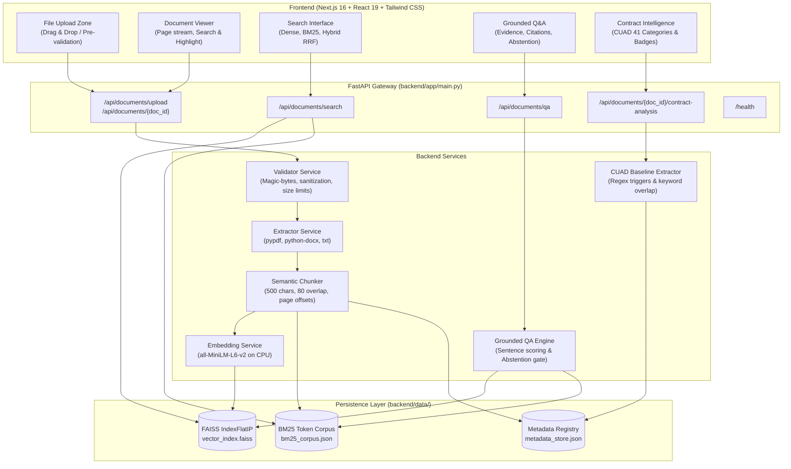

# AI Document Intelligence System

A local-first, evidence-grounded Document Intelligence platform built with **FastAPI**, **Next.js 16**, **TypeScript**, **Tailwind CSS**, and **FAISS**.

Designed for zero-cloud-cost operation (₹0 budget), this system provides deterministic document extraction, hybrid dense-lexical retrieval, extractive question answering with verifiable citations and conservative abstention, and an experimental legal contract clause analysis engine based on the CUAD benchmark.

---

## Table of Contents
1. [Real-World Problem & Solution](#real-world-problem--solution)
2. [Key Capabilities](#key-capabilities)
3. [System Architecture](#system-architecture)
4. [Technology Stack](#technology-stack)
5. [Prerequisites & Local Setup](#prerequisites--local-setup)
6. [Environment Variables](#environment-variables)
7. [API Reference & Usage](#api-reference--usage)
8. [Testing & Verified Test Counts](#testing--verified-test-counts)
9. [Dataset & Model Attribution](#dataset--model-attribution)
10. [Evaluation Results & Limitations](#evaluation-results--limitations)
11. [Containerization & Deployment Status](#containerization--deployment-status)
12. [License & Disclaimers](#license--disclaimers)

---

## Real-World Problem & Solution

### The Problem
Traditional generative question-answering systems (LLMs) applied to technical, legal, and financial documents present severe operational risks:
- **Hallucinations & Confabulation**: Generative models frequently fabricate dates, numeric terms, and contract obligations.
- **Unverifiable Citations**: Generic AI tools rarely point to exact page numbers or character offsets, forcing manual verification.
- **High Cloud API Costs**: Paying per-token fees for external APIs makes recurring batch document processing expensive.
- **Cross-Document Leakage**: Naive RAG setups often pool chunks from unrelated documents, causing answers to blend facts from different sources.

### The Solution
The **AI Document Intelligence System** operates entirely on standard CPU hardware with:
1. **Verifiable Provenance**: Every answerable response is linked to exact page numbers, start/end character offsets, and verbatim excerpts.
2. **Conservative Abstention**: When evidence is missing, conflicting, or falls below confidence thresholds, the system explicitly abstains rather than inventing answers.
3. **Strict Document Scope**: Queries can be scoped to a specific document ID to guarantee zero cross-document data leakage.
4. **Hybrid Retrieval**: Combines semantic embeddings (FAISS IndexFlatIP) with keyword frequency (Okapi BM25) via Reciprocal Rank Fusion (RRF).
5. **₹0-Cost Local Compute**: 100% deterministic local inference without paid API keys, external SaaS subscriptions, or GPU hardware.

---

## Key Capabilities

### 1. Multi-Format Ingestion & Deep Validation
- **Supported Formats**: `.pdf`, `.docx`, `.txt` up to 15 MB.
- **Integrity Validation**: Magic-byte signature checks (`%PDF-` for PDF, OpenXML ZIP headers for DOCX, null-byte / UTF-8 / Latin-1 inspection for TXT).
- **Safety**: Path traversal sanitization, chunked streaming to prevent memory denial-of-service, and ZIP decompression ratio limits (zip-bomb protection).
- **Page-Preserved Demarcation**:
  - **PDF**: Physical 1-indexed pages extracted via `pypdf`.
  - **DOCX**: XML explicit page break detection (`w:type="page"` and `w:lastRenderedPageBreak`) and structured paragraph chunking via `python-docx`.
  - **TXT**: ASCII Form-Feed (`\x0c`) pagination with logical section fallback.

### 2. Semantic Chunking & Local Embeddings
- **Chunking**: Structure-aware sliding window (default: 500 characters, 80 character overlap) preserving 1-indexed page references and exact character offsets.
- **Local Dense Embeddings**: `sentence-transformers/all-MiniLM-L6-v2` generating 384-dimensional unit-normalized float32 vectors.
- **FAISS Vector Store**: `IndexFlatIP` storing normalized embeddings where inner product is mathematically identical to cosine similarity.

### 3. Okapi BM25 & Reciprocal Rank Fusion (RRF)
- **Parallel Lexical Store**: `rank_bm25` enhanced with non-negative Lucene IDF:
  $$\text{IDF}(t) = \ln\left(1 + \frac{N - n(t) + 0.5}{n(t) + 0.5}\right)$$
- **Reciprocal Rank Fusion**: Merges dense and lexical candidate lists ($k=60$):
  $$\text{RRF\_score}(d) = \sum_{i} \frac{1}{k + \text{rank}_i(d)}$$
- Deduplicates chunks and boosts passages that score well across both semantic and exact keyword dimensions.

### 4. Grounded Question Answering with Citations
- **Extractive Grounding**: Sentence-level evidence scoring combining 60% semantic similarity and 40% query keyword overlap.
- **Anchor Penalty**: Queries with specific technical or legal terms are penalized if candidate sentences have zero lexical overlap.
- **Verifiable Citations**: Every positive answer returns a list of citations containing `doc_id`, `filename`, `page_number`, `start_char`, `end_char`, and verbatim excerpt.
- **Conservative Abstention**: If the best candidate score is below the threshold (default: 0.45), the system abstains with `answered: false` and `citations: []`.

### 5. Experimental Contract Intelligence (CUAD 41)
- **CUAD Baseline Extractor**: Heuristic trigger phrase and keyword matching covering all 41 standard CUAD clause categories.
- **Absence Distinction**: Categories with no detection are marked `detection_status="not_detected"` with an explicit explanation: *"Not detected by the experimental extractor. This does not verify legal absence."*
- **Source Offsets**: Detected clauses link directly to the interactive Document Reader at the exact page and character slice.
- **Isolated Module**: Runs purely on CPU heuristics without invoking DistilBERT or paid generative models.

---

## System Architecture



### Architectural Distinction
| Component | Engine | Scope | Compute |
|---|---|---|---|
| **Passage Search** | FAISS IndexFlatIP + BM25Okapi + RRF | General documents (PDF, DOCX, TXT) | CPU (SentenceTransformers + math) |
| **Grounded Q&A** | Hybrid Retriever + Sentence Grounding | User inquiries across uploaded documents | CPU (Cosine dot product + term overlap) |
| **Contract Analysis** | CUAD Category Trigger Baseline | Explicitly selected contracts (CUAD 41) | CPU (Regex patterns + keyword frequencies) |

---

## Technology Stack

### Backend
- **Framework**: FastAPI 0.115+, Uvicorn 0.30+
- **Data Validation**: Pydantic v2.8+
- **Vector Search**: FAISS (CPU) `faiss-cpu 1.8+`
- **Dense Embeddings**: `sentence-transformers 3.0+` (`all-MiniLM-L6-v2`, 384 dimensions)
- **Lexical Search**: `rank-bm25 0.2.2+`
- **Document Extractors**: `pypdf 5.0+`, `python-docx 1.1+`
- **Testing**: `pytest 8.0+`, `httpx 0.27+`

### Frontend
- **Framework**: Next.js 16.4 (App Router, Turbopack)
- **UI Library**: React 19, Lucide React icons
- **Styling**: Tailwind CSS v4
- **Language**: TypeScript 5+
- **Test Runner**: Node.js built-in test runner (`node --test`)

---

## Prerequisites & Local Setup

### Prerequisites
- **Python**: 3.10 to 3.14 (tested on Python 3.14 64-bit on Windows)
- **Node.js**: v18+ (tested on Node.js v24 on Windows)
- **Git**

---

### Step-by-Step Windows PowerShell Setup

#### 1. Clone Repository
```powershell
git clone <repository-url>
cd ai-document-intelligence
```

#### 2. Backend Setup
```powershell
# Navigate to backend directory
cd backend

# Create virtual environment
python -m venv venv

# Activate virtual environment
.\venv\Scripts\Activate.ps1

# Upgrade pip and install dependencies
python -m pip install --upgrade pip
pip install -r requirements.txt

# Create environment configuration from template
cp .env.example .env

# Start FastAPI backend server
python -m uvicorn app.main:app --host 0.0.0.0 --port 8000
```
Backend will be live at:
- **API Root**: [http://localhost:8000](http://localhost:8000)
- **Interactive Documentation**: [http://localhost:8000/docs](http://localhost:8000/docs)
- **Health Check**: [http://localhost:8000/health](http://localhost:8000/health)

#### 3. Frontend Setup
Open a **second PowerShell terminal**:
```powershell
# Navigate to frontend directory
cd frontend

# Install Node dependencies
npm install

# Create environment configuration from template
cp .env.example .env.local

# Start Next.js development server
npm run dev
```
Frontend will be live at:
- **Web Dashboard**: [http://localhost:3000](http://localhost:3000)

---

## Environment Variables

### Root (`.env.example`) & Backend (`backend/.env.example`)
| Variable | Default Value | Description |
|---|---|---|
| `HOST` | `0.0.0.0` | Network interface to bind backend server |
| `PORT` | `8000` | Port for the FastAPI application |
| `ENVIRONMENT` | `development` | Environment mode (`development` or `production`) |
| `ALLOWED_ORIGINS` | `http://localhost:3000,http://127.0.0.1:3000` | Comma-separated CORS allowed origins |
| `MAX_UPLOAD_SIZE_MB` | `15` | Maximum allowed file upload size in megabytes |
| `ENABLE_DOCS` | `true` | Toggle for Swagger UI (`/docs`) and ReDoc (`/redoc`) |
| `DATA_DIR` | `data` | Directory path for FAISS index and metadata storage |

### Frontend (`frontend/.env.example`)
| Variable | Default Value | Description |
|---|---|---|
| `NEXT_PUBLIC_API_URL` | `http://localhost:8000` | Backend API base URL accessible from user's browser |

---

## API Reference & Usage

### 1. Document Ingestion
**Endpoint**: `POST /api/documents/upload`
- **Request**: Multipart form data with file field `file` (`.pdf`, `.docx`, or `.txt`).
- **Response**:
```json
{
  "success": true,
  "doc_id": "doc_dfbbe8383910",
  "filename": "sample_agreement.pdf",
  "file_type": "PDF",
  "file_size_bytes": 10240,
  "file_size_formatted": "10.0 KB",
  "total_pages": 1,
  "total_characters": 850,
  "total_words": 120,
  "total_chunks": 2,
  "preview_text": "This Agreement is entered into...",
  "extracted_pages": [
    {
      "page_number": 1,
      "text": "Full extracted text...",
      "char_count": 850,
      "word_count": 120,
      "is_approximate": false,
      "boundary_type": "physical"
    }
  ],
  "message": "Successfully extracted 1 page(s), 120 word(s), and indexed 2 semantic chunk(s)."
}
```

### 2. Hybrid Passage Search
**Endpoint**: `POST /api/documents/search`
- **Request**:
```json
{
  "query": "governing law jurisdiction Delaware",
  "top_k": 3,
  "strategy": "hybrid"
}
```
- **Response**:
```json
{
  "query": "governing law jurisdiction Delaware",
  "total_results": 1,
  "results": [
    {
      "chunk_id": "doc_dfbbe8383910_p1_c0",
      "doc_id": "doc_dfbbe8383910",
      "filename": "sample_agreement.pdf",
      "page_number": 1,
      "chunk_index": 0,
      "score": 1.0,
      "text": "This Agreement shall be governed by and construed in accordance with the laws of the State of Delaware.",
      "start_char": 0,
      "end_char": 103,
      "boundary_type": "physical",
      "is_approximate": false
    }
  ],
  "search_time_ms": 12.4,
  "retrieval_strategy": "hybrid"
}
```

### 3. Grounded Q&A with Citations
**Endpoint**: `POST /api/documents/qa`
- **Request**:
```json
{
  "question": "What laws govern this agreement?",
  "top_k": 5,
  "doc_id": "doc_dfbbe8383910"
}
```
- **Answered Response**:
```json
{
  "question": "What laws govern this agreement?",
  "answered": true,
  "answer": "This Agreement shall be governed by and construed in accordance with the laws of the State of Delaware.",
  "confidence": 0.784,
  "abstention_reason": null,
  "citations": [
    {
      "citation_id": "cit_1",
      "doc_id": "doc_dfbbe8383910",
      "filename": "sample_agreement.pdf",
      "page_number": 1,
      "chunk_id": "doc_dfbbe8383910_p1_c0",
      "start_char": 0,
      "end_char": 103,
      "supporting_excerpt": "This Agreement shall be governed by and construed in accordance with the laws of the State of Delaware.",
      "relevance_score": 0.784
    }
  ],
  "latency_ms": 85.2
}
```
- **Abstention Response**:
```json
{
  "question": "What is the penalty for late cloud backup sync?",
  "answered": false,
  "answer": "I could not find sufficient evidence in the uploaded document(s) to answer this question.",
  "confidence": 0.12,
  "abstention_reason": "insufficient_evidence",
  "citations": [],
  "latency_ms": 42.1
}
```

### 4. Contract Clause Analysis (CUAD 41)
**Endpoint**: `POST /api/documents/{doc_id}/contract-analysis`
- **Request**:
```json
{
  "confidence_threshold": 3.0
}
```
- **Response**:
```json
{
  "doc_id": "doc_dfbbe8383910",
  "filename": "sample_agreement.pdf",
  "total_pages": 1,
  "total_chunks_scanned": 2,
  "categories_analyzed": 41,
  "clauses_detected_count": 1,
  "clauses_not_detected_count": 40,
  "disclaimer": "ACADEMIC DEMONSTRATION ONLY: This analysis is produced by an experimental heuristic trigger extractor (CUAD baseline)...",
  "results": [
    {
      "category": "Governing Law",
      "detected": true,
      "extracted_text": "This Agreement shall be governed by and construed in accordance with the laws of the State of Delaware.",
      "page_number": 1,
      "start_char": 0,
      "end_char": 103,
      "confidence_score": 14.0,
      "detection_status": "detected",
      "explanation": "Candidate clause detected with heuristic trigger score 14.0 on page 1."
    },
    {
      "category": "Non-Compete",
      "detected": false,
      "extracted_text": null,
      "detection_status": "not_detected",
      "explanation": "Not detected by the experimental extractor. This does not verify legal absence."
    }
  ]
}
```

---

## Testing & Verified Test Counts

All test counts reflect freshly executed commands:

### Backend Test Suite
```powershell
cd backend
.\venv\Scripts\Activate.ps1
pytest tests/
```
- **Result**: **120 passed in 31.26s** (0 failures, 0 errors).
  - Ingestion & validation (`test_documents.py`): 17 tests
  - Semantic chunking & vector search (`test_phase2_vector_search.py`): 9 tests
  - BM25 & Reciprocal Rank Fusion (`test_phase3_hybrid_retrieval.py`): 43 tests
  - CUAD Benchmark evaluation (`test_phase4_benchmark.py`): 9 tests
  - CUAD Dataset integrity (`test_phase4_cuad_dataset.py`): 10 tests
  - CUAD Model baselines (`test_phase4_cuad_models.py`): 11 tests
  - Contract Intelligence API (`test_phase5_contract_intelligence.py`): 8 tests
  - Grounded Q&A & citations (`test_phase5_grounded_qa.py`): 11 tests
  - Store restart persistence (`test_restart_persistence.py`): 1 test
  - Retrieval evaluation (`test_retrieval_evaluation.py`): 1 test

### Frontend Test Suite
```powershell
cd frontend
npm test
```
- **Result**: **15 passed in 166ms** (`smoke.test.mjs`, `qa_integration.test.mjs`, `contract_intelligence.test.mjs`).

### Live End-to-End Workflow Verification
```powershell
cd backend
python tests/e2e_verification.py
```
- **Result**: **12 sequential verification steps passed** against live local services:
  - Step 0: Service health checks (Backend & Frontend)
  - Step 1 & 2: PDF, DOCX, and TXT upload and indexing
  - Step 3: Dense, BM25, and Hybrid RRF searches
  - Step 4: Answerable Grounded Q&A with citations
  - Step 5: Conservative abstention (zero citations)
  - Step 6: Strict document scope enforcement
  - Step 7: Verifiable character offset boundary integrity
  - Step 8: Document metadata restoration across simulated refresh
  - Step 9: CUAD 41 contract analysis & absence distinction
  - Step 10: Input validation & error responses (400 on .exe/empty, 404 on missing IDs)
  - Step 11: Deletion consistency across FAISS and BM25 registries

### Production Build
```powershell
cd frontend
npm run build
```
- **Result**: **Compiled successfully in 1217ms**, TypeScript verified in 3.2s, 4/4 static pages generated with 0 errors.

---

## Dataset & Model Attribution

1. **Dense Embedding Model**:
   - Model: `sentence-transformers/all-MiniLM-L6-v2`
   - Architecture: 6-layer MiniLM, 384-dimensional dense representation
   - License: Apache 2.0
   - Weights Disk Size: ~90 MB
2. **Benchmark Dataset**:
   - Dataset: Contract Understanding Atticus Dataset (CUAD v1)
   - Authors: Dan Hendrycks et al. (The Atticus Project)
   - Scope: 510 commercial legal agreements across 41 clause categories
   - License: Creative Commons Attribution 4.0 International (CC BY 4.0)
3. **Lexical Retrieval Engine**:
   - Library: `rank-bm25` (Okapi BM25 implementation)
   - License: MIT License

---

## Evaluation Results & Limitations

### 1. Phase 4 CUAD Extraction Evaluation
Evaluated against the CUAD test split (3 commercial contracts, 123 queries):
- **Lexical Trigger Baseline Extractor**:
  - Extractive Detection F1: **26.67%** (Detection Precision: 38.46%, Recall: 20.41%)
  - Answerable Token F1: **62.30%**
  - Answerable Exact Match: **18.37%**
- **DistilBERT Transformer Pilot**:
  - Pretrained QA model showed token overlap on answerable clauses, but low precision due to zero domain adaptation on complex legal contracts.
  - Fine-tuning pilot (40 sliding windows) confirmed that small parameter runs on CPU do not produce reliable contract extraction without extensive GPU training.
- **Architectural Decision**: General document Q&A uses the production hybrid retrieval engine with sentence-level grounding. The legal contract analyzer exposes the baseline extractor as an academic demonstration only.

### 2. Measured Resource Requirements
- **Backend Idle**: ~180 MB RAM.
- **Backend Active with Model Loaded**: **585.12 MB RAM** (measured working set with PyTorch + SentenceTransformers).
- **Frontend Dev Server**: ~323 MB RAM; Production runner: ~85–120 MB RAM.
- **Recommended Minimum RAM**: **$\ge 1\text{ GB}$**.

### 3. Known Limitations & Constraints
- **Render / Fly Free Tier Incompatibility**: Free cloud tiers with $\le 512\text{ MB}$ RAM will crash from out-of-memory (OOM) `SIGKILL` when PyTorch loads the embedding model.
- **Ephemeral Storage**: Free cloud web services wipe local disk storage on container restarts. Uploaded documents and vector indexes will be lost without a persistent disk volume.
- **Academic Demonstration Only**: The CUAD contract intelligence module is a heuristic baseline and does **NOT** provide legal advice. Non-detection of a clause does not prove legal absence.

---

## Containerization & Deployment Status

### Docker Configuration
- [`backend/Dockerfile`](file:///C:/Users/Ayush%20SIngh/.gemini/antigravity-ide/scratch/ai-document-intelligence/backend/Dockerfile): Python 3.11-slim, CPU-optimized PyTorch wheel (`--index-url https://download.pytorch.org/whl/cpu`), offline model pre-caching (`HF_HOME=/app/model_cache`), and healthcheck.
- [`frontend/Dockerfile`](file:///C:/Users/Ayush%20SIngh/.gemini/antigravity-ide/scratch/ai-document-intelligence/frontend/Dockerfile): Multi-stage Node 20-Alpine build baking `NEXT_PUBLIC_API_URL`.
- [`docker-compose.yml`](file:///C:/Users/Ayush%20SIngh/.gemini/antigravity-ide/scratch/ai-document-intelligence/docker-compose.yml): Orchestrates services with named volume `doc_intel_data:/app/data` for persistent index storage.
- [`.dockerignore`](file:///C:/Users/Ayush%20SIngh/.gemini/antigravity-ide/scratch/ai-document-intelligence/backend/.dockerignore): Configured on both backend and frontend to exclude virtualenvs, local caches, raw datasets, and `.env` files.

### Deployment Status
| Environment | Status | Details |
|---|---|---|
| **Local Native Execution** | **VERIFIED OPERATIONAL** | Tested on Windows host; all endpoints, UI tabs, and E2E flows passing. |
| **Local Docker Compose** | **CONFIGURED (PENDING RUNTIME)** | Dockerfiles and compose files are complete and audited. Live container startup was not executed because the host's Docker Desktop service was stopped during audit. |
| **Public Cloud Deployment** | **NOT VERIFIED** | Not deployed to public cloud URLs. Requires a cloud VM or host with $\ge 1\text{ GB}$ RAM and persistent volume storage. |

---

## License & Disclaimers

### License
This project is open-source software licensed under the MIT License. Embedded dependencies and models retain their respective licenses (Apache 2.0 for sentence-transformers, MIT for rank-bm25, CC BY 4.0 for CUAD).

### Legal & Safety Disclaimer
This software is provided for educational, research, and technical portfolio demonstration purposes only. The contract intelligence features do not constitute legal advice, formal contract audit, or guaranteed compliance checks. Always consult a qualified attorney for legal contract analysis.
